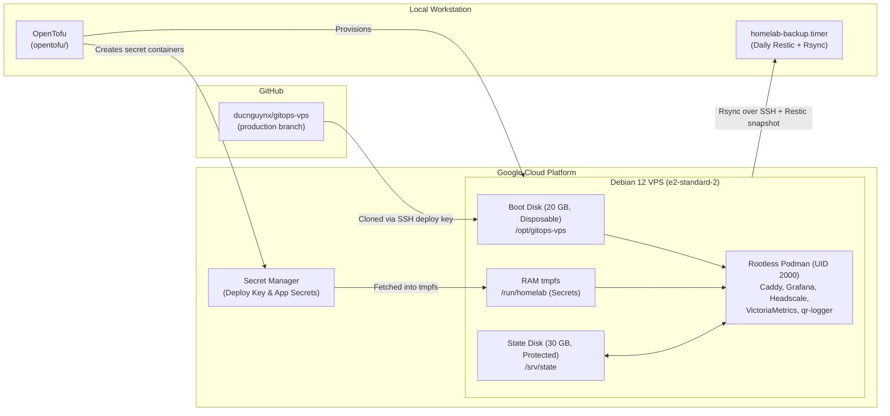

# GCP Homelab VPS — Infrastructure, GitOps Runtime & Workstation Backups

This repository provisions and operates a reproducible, GitOps-driven homelab VPS on Google Cloud Platform (GCP) using **OpenTofu**, **rootless Podman**, and **Restic** workstation backups.

---

## Architecture Overview



### What This Repository Manages

1. **Cloud Infrastructure (`opentofu/*.tf`)**:
   - Custom VPC, regional subnet, and firewall rules (`TCP/22` SSH and `TCP/80,443` Web).
   - Regional static external IPv4 address.
   - `e2-standard-2` Debian 12 VM with a **disposable 20 GB boot disk** (`auto_delete = true`).
   - Separately managed **30 GB persistent state disk** (`prevent_destroy = true`), mounted at `/srv/state`.
   - Least-privilege runtime service account granted `roles/secretmanager.secretAccessor` on four GCP Secret Manager secrets:
     - `github-deploy-key` (OpenSSH private key for cloning `gitops-vps`)
     - `grafana-admin-password` (plain text)
     - `spotify-oauth` (JSON)
     - `youtube-oauth` (JSON)

2. **VM Bootstrap & GitOps Runtime (`opentofu/templates/`)**:
   - **`bootstrap.sh.tftpl`**: Runs once on first boot as `root`. Installs `podman`, `podman-compose`, `git`, `jq`, and rootless container dependencies; creates user `vps-app` (`UID 2000`) with a fixed subordinate ID range (`200000:65536`); hardens `sshd`; safely formats (if blank) and mounts `/srv/state`; installs helper scripts into `/usr/local/libexec/homelab/` and systemd units into `/etc/systemd/system/`.
   - **`scripts/repository-bootstrap`** (`homelab-repository.service`): Fetches `github-deploy-key` from Secret Manager into RAM and clones the `production` branch of `git@github.com:ducnguynx/gitops-vps.git` into `/opt/gitops-vps` (or verifies the existing checkout).
   - **`scripts/render-secrets`** (`homelab-secrets.service`): Fetches `spotify-oauth`, `youtube-oauth`, and `grafana-admin-password` from Secret Manager and writes them atomically into `/run/homelab/` (`tmpfs` in RAM, mode `0700`).
   - **`homelab-app.service`**: Waits for `/srv/state`, the GitOps checkout, and `/run/homelab` secrets, then starts the rootless Podman stack (`podman-compose up -d --force-recreate --remove-orphans`).
   - **`scripts/deploy`** (`homelab-deploy.service`): On-demand GitOps updater that fetches the latest `production` commit from GitHub, resets `/opt/gitops-vps`, refreshes runtime secrets, validates the compose stack, and restarts `homelab-app.service`.

3. **Workstation Backup & Export (`backups/`)**:
   - **`scripts/homelab-backup`** (`homelab-backup.service` & `homelab-backup.timer`): Runs daily on the local workstation. Stops `homelab-app.service` on the VPS (with a trap guaranteeing restart), flushes buffers, incrementally syncs `/srv/state` via `rsync` into `/home/homelab-backup/mirror/current`, restarts `homelab-app.service`, and creates a Restic snapshot in `/home/homelab-backup/repository`.
   - **`scripts/homelab-state-export`**: On-demand script to pull a consistent copy of `/srv/state` into local `tmpfs` (`/tmp/homelab-state.XXXXXXXX`) for inspection or migration.
   - **`scripts/homelab-backup-maintenance`** (`systemd/homelab-backup-maintenance.{service,timer}`): Runs weekly on Sundays at `04:00` to prune snapshots (`7 daily, 4 weekly, 6 monthly`) and verify Restic repository integrity (`restic check`).

---

## Safety Properties

- **VM deletion protection**: `deletion_protection = true` on the Compute Engine instance prevents accidental VM deletion.
- **Protected state disk**: `prevent_destroy = true` on the 30 GB state disk ensures application data survives VM recreation.
- **Non-destructive disk formatting**: The bootstrap script only formats the state disk if neither a filesystem nor any partition/filesystem signature (`blkid` and `wipefs`) exists.
- **Zero secrets in Git or OpenTofu state**: OpenTofu only creates empty Secret Manager secret containers. Secret values are uploaded out-of-band and rendered only into RAM (`/run/homelab`) at runtime.
- **Stable rootless UID mapping**: Subordinate UIDs/GIDs (`200000:65536`) and application UID (`2000`) are pinned so container file ownership on `/srv/state` remains identical across VM replacements:
  ```text
  /srv/state/
  ├── caddy/          (2000:2000)
  │   ├── config/
  │   └── data/
  ├── grafana/        (200471:2000 — mapped from container UID 472)
  ├── headscale/      (2000:2000)
  ├── qr-logger/      (2000:2000)
  └── victoriametrics/(2000:2000)
  ```

---

## Step-by-Step Setup

### 1. Prepare a dedicated SSH key

If the key does not already exist on your workstation:

```bash
ssh-keygen \
  -t ed25519 \
  -a 64 \
  -f ~/.ssh/gcp-homelab_ed25519 \
  -C "gcp-homelab"
```

### 2. Configure OpenTofu variables

From the `opentofu/` directory:

```bash
cd opentofu
cp terraform.tfvars.example terraform.tfvars
```

Edit `terraform.tfvars` and set your `project_id` and `ssh_source_ranges` (prefer your `/32` public IP when static).

### 3. Initialize, plan, and apply

```bash
mkdir -p state
tofu init
tofu fmt -recursive
tofu validate
tofu plan -out=tfplan
tofu apply tfplan
```

### 4. Populate GCP Secret Manager payloads

Before the VM's `homelab-repository.service` and `homelab-secrets.service` can succeed, upload secret versions to GCP Secret Manager:

```bash
gcloud secrets versions add github-deploy-key --data-file=/path/to/gitops-deploy-key
gcloud secrets versions add grafana-admin-password --data-file=/path/to/grafana-password.txt
gcloud secrets versions add spotify-oauth --data-file=/path/to/spotify-oauth.json
gcloud secrets versions add youtube-oauth --data-file=/path/to/youtube-oauth.json
```

If the VM booted before secrets were uploaded, start the application stack over SSH once the secrets are in place:

```bash
ssh homelab-vps "sudo systemctl start homelab-app.service"
```

---

## Day-2 Operations

### Deploying GitOps Changes (on the VPS)

After pushing changes to the `production` branch of `ducnguynx/gitops-vps`, trigger a deployment on the VPS:

```bash
ssh homelab-vps "sudo systemctl start homelab-deploy.service"
```

Check deployment and service logs:

```bash
ssh homelab-vps "sudo journalctl -u homelab-deploy.service -u homelab-app.service -n 50 --no-pager"
```

### Installing Workstation Backup Timers (on your local machine)

1. Install the scripts to `/usr/local/sbin/`:
   ```bash
   sudo install -o root -g root -m 0700 backups/scripts/homelab-backup /usr/local/sbin/homelab-backup
   sudo install -o root -g root -m 0750 backups/scripts/homelab-backup-maintenance /usr/local/sbin/homelab-backup-maintenance
   sudo install -o root -g root -m 0700 backups/scripts/homelab-state-export /usr/local/sbin/homelab-state-export
   ```
2. Install the systemd units and enable the timers:
   ```bash
   sudo install -o root -g root -m 0644 backups/systemd/* /etc/systemd/system/
   sudo systemctl daemon-reload
   sudo systemctl enable --now homelab-backup.timer homelab-backup-maintenance.timer
   ```
3. Run a manual backup or state export at any time:
   ```bash
   sudo /usr/local/sbin/homelab-backup
   sudo /usr/local/sbin/homelab-state-export
   ```
